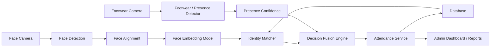
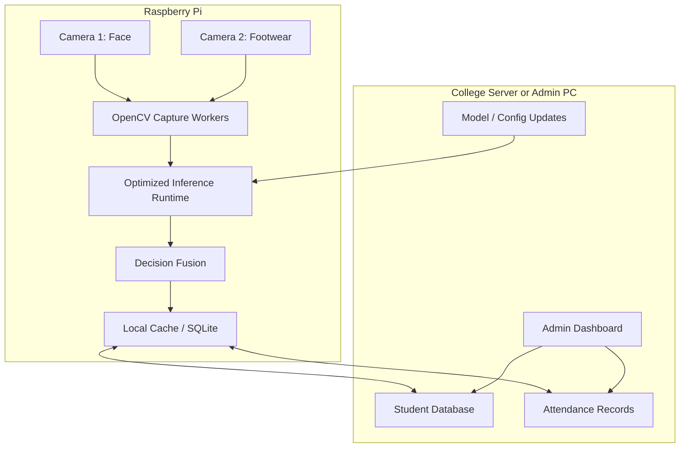
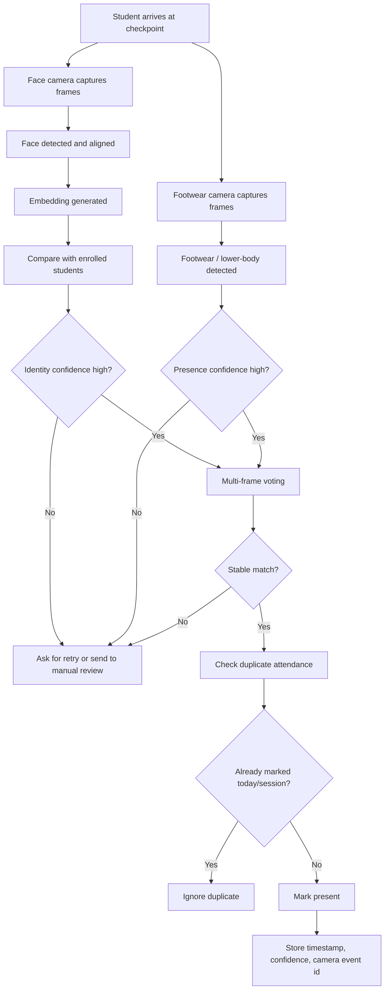
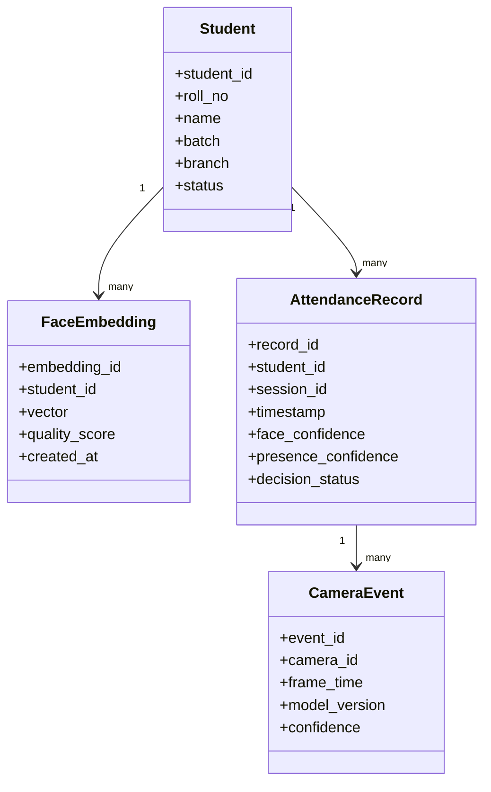

# AI Attendance System

An edge-ready attendance system designed for colleges and institutions. The system verifies a student using two independent computer-vision signals:

1. Face recognition camera: identifies the enrolled student.
2. Footwear/presence camera: confirms that a real person is physically standing at the checkpoint.

The final deployment target is Raspberry Pi with two cameras, while model training and experimentation are performed first on a PC.

## Project Status

This repository currently contains the initial senior-provided resources:

| Path | Purpose | Status |
| --- | --- | --- |
| `face_recognition_simple.py` | Compatibility wrapper for student enrollment | Working baseline |
| `shoe_detection_only.py` | Compatibility wrapper for footwear detection test | Working baseline |
| `src/app/enroll_student.py` | Enrolls a student face into SQLite | Working baseline |
| `src/app/run_attendance.py` | Two-camera attendance prototype | Working baseline |
| `src/footwear/run_detector.py` | Tests YOLO footwear detection | Working baseline |
| `models/footwear/shoe_detect_best.pt` | Recovered usable YOLO shoe model | Working baseline |
| `shoe_detect_best.pt/` | Original extracted checkpoint resource | Preserved |

The repository now has a first PC prototype structure. The current face recognition engine is a lightweight OpenCV baseline for wiring the system. For the final accuracy target, replace it with a stronger ArcFace or InsightFace-style embedding model.

## Problem Statement

Manual attendance is slow, error-prone, and easy to manipulate. A single-camera face recognition system can also fail when lighting changes, faces are partially visible, hairstyles change, students look tired, or someone tries to spoof the camera using a photo.

This project improves reliability by combining face recognition with a second visual confirmation signal. Attendance is marked only when the system has enough confidence that:

- the student identity is recognized,
- a physical person is present at the checkpoint,
- the same detection event is stable across multiple frames,
- duplicate attendance is prevented for the same session.

## Goals

- Support 1500+ enrolled students.
- Require only a small number of enrollment images per student, ideally one high-quality image plus optional future updates.
- Handle normal appearance variation such as hairstyle changes, pimples, tiredness, glasses, lighting changes, and mild pose changes.
- Detect footwear or lower-body presence, including sneakers, formal shoes, sandals, slippers, and similar categories.
- Achieve high practical accuracy through careful data collection, thresholds, multi-frame voting, and human review for uncertain cases.
- Run efficiently on Raspberry Pi after PC validation.

## Non-Goals

- The system should not promise 95%+ accuracy without a measured test set.
- The system should not train a separate classifier from scratch for every student.
- The system should not mark attendance from a single weak frame.
- The system should not store unnecessary raw biometric data when embeddings and controlled enrollment images are enough.

## Recommended Technical Direction

### Face Recognition

Use a face embedding pipeline instead of training a normal image classifier for 1500 students.

Recommended approach:

- Detect face using a robust detector.
- Align and crop the face.
- Generate a face embedding using a pretrained recognition model.
- Store student embeddings in the database.
- Compare live embedding with stored embeddings using cosine similarity or L2 distance.
- Use thresholding plus multi-frame voting before accepting identity.

Why this is better:

- It scales better to 1500+ students.
- New students can be added without retraining the whole model.
- One or a few enrollment images can work better than a class-based classifier trained on limited student photos.

Possible model families:

- FaceNet-style embedding models
- ArcFace-style embedding models
- InsightFace-compatible models
- OpenCV-based face detection utilities for preprocessing

### Footwear / Presence Detection

Use YOLO-style object detection for the second camera.

Recommended classes:

- `shoe`
- `sneaker`
- `sandal`
- `slipper`
- `footwear`
- optional: `person_lower_body`, `leg`, `foot`

For production, the exact class design should be tested. A simpler `footwear` class may generalize better than many small categories if the dataset is limited.

### Edge Deployment

Train and evaluate on PC first. For Raspberry Pi, export the model to an edge-friendly format such as NCNN, ONNX, TensorFlow Lite, or another supported runtime depending on the final model stack.

Current recommendation:

- Use Ultralytics YOLO for prototyping object detection.
- Prefer a small model variant for Raspberry Pi.
- Benchmark real FPS on the target Pi before locking the model.
- Keep OpenCV for camera input, preprocessing, visualization, and basic frame handling.
- Use Roboflow for dataset labeling, augmentation, train/validation/test splitting, and exporting detection datasets.

## System Architecture



## Raspberry Pi Deployment Architecture



## Attendance User Flow



## Main Components



## Database Design

Minimum recommended tables:

| Table | Purpose |
| --- | --- |
| `students` | Roll number, name, branch, batch, status |
| `face_embeddings` | One or more embeddings per student |
| `attendance_sessions` | Class/date/session metadata |
| `attendance_records` | Final attendance decisions |
| `camera_events` | Raw model decision metadata for audit/debugging |
| `model_versions` | Model name, version, threshold, deployment date |
| `manual_reviews` | Low-confidence or disputed cases |

For local prototype, SQLite is enough. For multi-device deployment, PostgreSQL or MySQL is better.

## Decision Logic

Suggested attendance rule:

```text
Mark present only if:
    face_match_confidence >= FACE_THRESHOLD
    and presence_confidence >= PRESENCE_THRESHOLD
    and same identity wins in N out of M recent frames
    and attendance is not already marked for the active session
```

Recommended safeguards:

- Use multi-frame voting instead of one-frame decisions.
- Add cooldown to prevent duplicate entries.
- Save low-confidence events for manual review.
- Reject frames with poor face quality, blur, extreme pose, or low brightness.
- Keep model thresholds configurable.

## Edge Cases And Mitigation

| Edge Case | Mitigation |
| --- | --- |
| Tired face, pimples, small hairstyle change | Use embeddings, face alignment, quality filtering, and multiple enrollment images over time |
| Glasses or light facial changes | Add augmentation and collect optional second image with glasses |
| Bad lighting | Add controlled checkpoint lighting and brightness checks |
| Face partially hidden | Reject low-quality frame and request retry |
| Sneaker, slipper, sandal, formal shoe | Train footwear detector with diverse classes or general footwear class |
| Student shows face but no physical presence | Require second camera presence signal |
| Duplicate attendance | Session-level duplicate check and cooldown |
| Similar-looking students | Stricter threshold, top-2 distance gap check, manual review |
| Spoofing using photo | Add liveness later: blink/head movement/depth/temporal checks |
| Camera disconnect | Health check, fallback alert, no silent attendance marking |

## Dataset Strategy

### Face Dataset

Do not rely on public faces to identify college students directly. Public datasets are useful for learning general facial features, but enrolled students still need real enrollment images.

Practical plan:

1. Use a pretrained face embedding model.
2. Enroll each student with at least one high-quality image.
3. Prefer 3 to 5 images per student over time if possible.
4. Store embeddings, not only raw images.
5. Add controlled augmentation for brightness, blur, small rotation, and contrast.
6. Build a validation set from real checkpoint-like images.

### Footwear Dataset

Use Roboflow or a similar labeling tool to build a footwear detection dataset.

Recommended dataset requirements:

- Different footwear types: sneakers, slippers, sandals, formal shoes.
- Different floor colors and backgrounds.
- Different angles and distances from camera.
- Occlusion cases such as bags or other students nearby.
- Train/validation/test split with no duplicate frames across splits.

## Accuracy Measurement

The 95%+ target should be measured with real metrics:

| Metric | Meaning |
| --- | --- |
| Face TAR / FAR | True accept rate and false accept rate |
| Top-1 identity accuracy | Correct student selected as best match |
| False present rate | Attendance incorrectly marked |
| False reject rate | Real student not accepted |
| Footwear mAP | Object detection quality |
| End-to-end attendance accuracy | Final system decision accuracy |
| FPS and latency | Raspberry Pi performance |

Recommended test protocol:

- Test at least several hundred real checkpoint attempts.
- Include lighting variation, hairstyle variation, glasses, tired faces, and partial occlusion.
- Measure false accept rate very strictly because marking the wrong student present is worse than asking for retry.

## Suggested Folder Structure

```text
Attendence/
|-- README.md
|-- data/
|   |-- raw/
|   |-- processed/
|   `-- roboflow/
|-- models/
|   |-- face/
|   `-- footwear/
|-- src/
|   |-- cameras/
|   |-- face/
|   |-- footwear/
|   |-- fusion/
|   |-- database/
|   `-- app/
|-- tests/
|-- scripts/
|-- configs/
`-- docs/
```

## Development Roadmap

### Phase 1: PC Prototype

- Implement face enrollment.
- Implement face embedding search.
- Load and test footwear detector.
- Build a basic attendance decision engine.
- Store students and attendance records in SQLite.

### Phase 2: Dataset And Evaluation

- Collect sample student enrollment images.
- Build footwear dataset in Roboflow.
- Define train/validation/test split.
- Measure recognition accuracy and false accept rate.
- Tune thresholds and multi-frame voting.

### Phase 3: Integration

- Run two camera streams together.
- Synchronize face and footwear events.
- Add duplicate prevention.
- Add manual review flow.
- Add logs and model versioning.

### Phase 4: Raspberry Pi Optimization

- Export detection model to an optimized runtime.
- Benchmark FPS, latency, CPU/RAM usage, and temperature.
- Reduce model size if needed.
- Add startup scripts and camera health checks.

### Phase 5: Production Hardening

- Add admin dashboard.
- Add backup and restore.
- Add audit logs.
- Add privacy controls.
- Add deployment documentation.

## Installation

Install dependencies:

```bash
pip install -r requirements.txt
```

Python 3.13 is currently being used on this machine. Some advanced face-recognition libraries may require Python 3.10 or 3.11, so the face engine is isolated in `src/face/` for an easier upgrade later.

## Running

If you are new to ML, start with the beginner guide:

[docs/BEGINNER_GUIDE.md](docs/BEGINNER_GUIDE.md)

Quick system check:

```bash
python -m src.app.doctor
```

Initialize the database:

```bash
python -m src.database.init_db
```

Enroll a student from an image:

```bash
python -m src.app.enroll_student --roll-no 101 --name "Test Student" --branch CSE --batch 2026 --image path/to/student.jpg
```

Enroll a student from webcam:

```bash
python -m src.app.enroll_student --roll-no 101 --name "Test Student" --branch CSE --batch 2026
```

Test face recognition and mark face-only demo attendance from PC webcam:

```bash
python -m src.app.test_face_camera --camera 0
```

Show saved attendance:

```bash
python -m src.app.show_attendance
```

Test footwear detection:

```bash
python -m src.footwear.run_detector --model models/footwear/shoe_detect_best.pt --source 0
```

Run the two-camera attendance prototype:

```bash
python -m src.app.run_attendance --face-camera 0 --footwear-camera 1
```

If only one camera is connected, test enrollment and footwear detection separately first.

## References

- Ultralytics YOLO documentation: https://docs.ultralytics.com/
- Roboflow dataset export documentation: https://docs.roboflow.com/datasets/exporting-data
- OpenCV documentation: https://docs.opencv.org/

## Notes For Evaluation

This project should be presented as an engineering system, not just a model. Accuracy will come from:

- using pretrained models correctly,
- collecting realistic validation data,
- setting conservative thresholds,
- combining two camera signals,
- rejecting uncertain cases,
- measuring failure cases honestly.

The most professional version of this project is one that can explain when it is confident, when it is uncertain, and why an attendance record was created.
